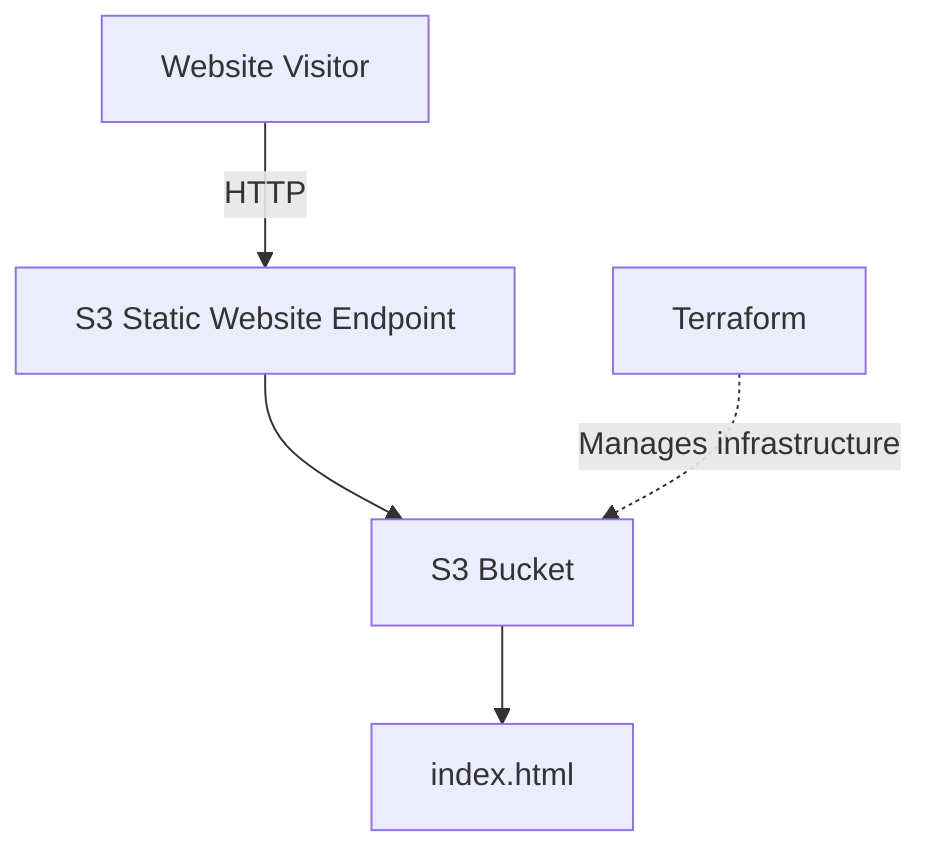

# AWS Static Website

A simple static website hosted on Amazon S3, displaying my name.

## Architecture



The website is served directly from S3. Terraform is used to provision and manage the AWS resources.

## How to run

**Prerequisites:** AWS CLI v2 and Terraform >= 1.3.

1. Configure AWS credentials:

```bash
aws configure --profile terraform
```

2. Initialize and deploy:

```bash
cd infrastructure
terraform init
terraform apply
```

3. Get the website URL:

```bash
terraform output -raw website_url
```

4. To update the website, edit files in `website/` and push to `main` (see [CI/CD](#cicd)), or run `terraform apply` again.

5. To remove the infrastructure:

```bash
terraform destroy
```

## CI/CD

The GitHub Actions workflow [`.github/workflows/deploy.yml`](.github/workflows/deploy.yml) publishes the website files to S3:

- **Triggers:** any push to `main`, or a manual run from the Actions tab.
- **Action:** `aws s3 sync website/ s3://static-website-dev-061700273493 --delete`. Files removed from `website/` are also removed from the bucket.
- **Scope:** the workflow only deploys site content. Infrastructure changes are still applied locally with `terraform apply`, because Terraform state is stored locally and is not available in CI.

**Required repository secrets** (Settings → Secrets and variables → Actions):

| Secret | Purpose |
|---|---|
| `AWS_ACCESS_KEY_ID` | Access key of a dedicated IAM user |
| `AWS_SECRET_ACCESS_KEY` | Secret for that access key |

The IAM user should have least-privilege access: `s3:ListBucket` on the bucket, and `s3:PutObject` and `s3:DeleteObject` on `bucket/*`.

If you change `project_name`, `environment` or the region, update `BUCKET` and `AWS_REGION` in the workflow to match.

## Notes

The current implementation uses public S3 static website hosting over HTTP. A production deployment would use private S3 storage behind CloudFront with OAC and HTTPS.