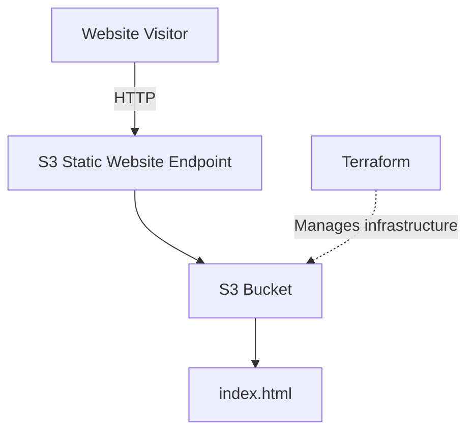

# AWS Static Website

A simple static website hosted on Amazon S3, displaying my name.

## Architecture



The website is served directly from S3. Terraform is used to provision and manage the AWS resources.

## How to run

**Prerequisites:** AWS CLI v2 and Terraform >= 1.3.

1. Configure AWS credentials:

```bash
aws configure --profile terraform
```

2. Initialize and deploy:

```bash
cd infrastructure
terraform init
terraform apply
```

3. Get the website URL:

```bash
terraform output -raw website_url
```

4. To update the website, edit files in `website/` and run `terraform apply` again.

5. To remove the infrastructure:

```bash
terraform destroy
```

## Notes

The current implementation uses public S3 static website hosting over HTTP. A production deployment would use private S3 storage behind CloudFront with OAC and HTTPS.