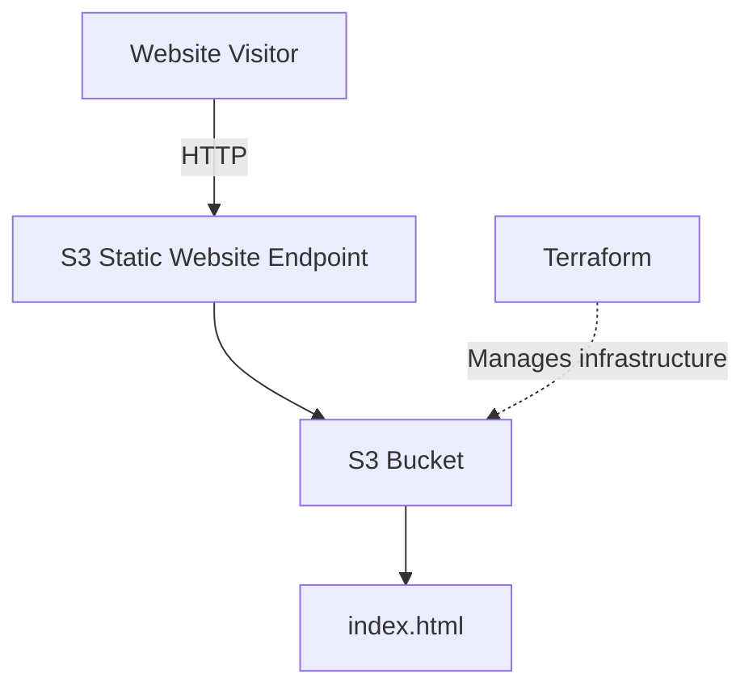
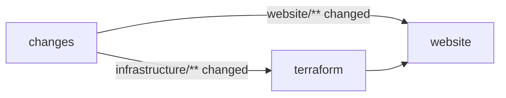

# AWS Static Website

A simple static website hosted on Amazon S3, displaying my name.

## Architecture



The website is served directly from S3. Terraform is used to provision and manage the AWS resources.

## How to run

**Prerequisites:** AWS CLI v2 and Terraform >= 1.10.

1. Configure AWS credentials:

```bash
aws configure --profile terraform
```

2. Initialize and deploy:

```bash
cd infrastructure
AWS_PROFILE=terraform terraform init
AWS_PROFILE=terraform terraform apply
```

3. Get the website URL:

```bash
terraform output -raw website_url
```

4. To update the website, edit files in `website/` and push to `main` (see [CI/CD](#cicd)), or run `terraform apply` again.

5. To remove the infrastructure:

```bash
terraform destroy
```

## CI/CD

A single workflow, [`.github/workflows/deploy.yml`](.github/workflows/deploy.yml), runs on every push to `main` and can also be started manually from the Actions tab (`workflow_dispatch`, which runs both parts).



| Changed | Result |
|---|---|
| `website/` only | Sync website to S3 |
| `infrastructure/` only | Terraform `fmt -check`, `init`, `validate`, `plan`, `apply` |
| Both | Terraform first, then website sync |
| Neither | Everything skipped |

- **Change detection:** the `changes` job uses `dorny/paths-filter`.
- **Ordering:** the `website` job waits for `terraform` and does not run if it fails.
- **Website deploy:** `aws s3 sync website/ s3://static-website-dev-061700273493 --delete`. Files removed from `website/` are also removed from the bucket.
- **Terraform state:** stored remotely in the S3 backend configured in [`infrastructure/main.tf`](infrastructure/main.tf) (bucket `terraform-state-bucket-20261102`, with encryption and S3 lock file). CI sets `TF_VAR_aws_profile=""` so it uses the secrets instead of the local `terraform` profile.
- **Local runs:** the backend can't use the `aws_profile` variable, so prefix commands with `AWS_PROFILE=terraform`. If you applied with local state before, run `terraform init -migrate-state` once.

**Required repository secrets** (Settings → Secrets and variables → Actions):

| Secret | Purpose |
|---|---|
| `AWS_ACCESS_KEY_ID` | Access key of a dedicated IAM user |
| `AWS_SECRET_ACCESS_KEY` | Secret for that access key |

The IAM user needs:
- Access to the state bucket: `s3:ListBucket`, `s3:GetObject`, `s3:PutObject` and `s3:DeleteObject` (the last for the lock file).
- Permissions to manage the site bucket's configuration, policy and objects (Terraform apply), plus `s3:ListBucket`, `s3:PutObject` and `s3:DeleteObject` for the website sync.

If you change `project_name`, `environment` or the region, update `BUCKET` and `AWS_REGION` in the workflow to match.

## Notes

The current implementation uses public S3 static website hosting over HTTP. A production deployment would use private S3 storage behind CloudFront with OAC and HTTPS.