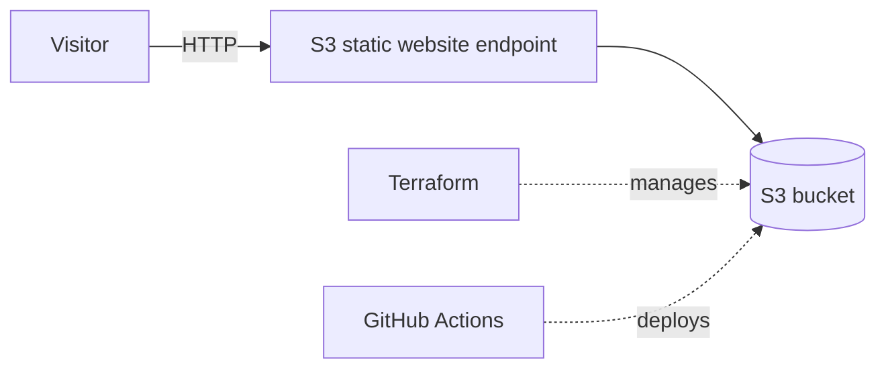
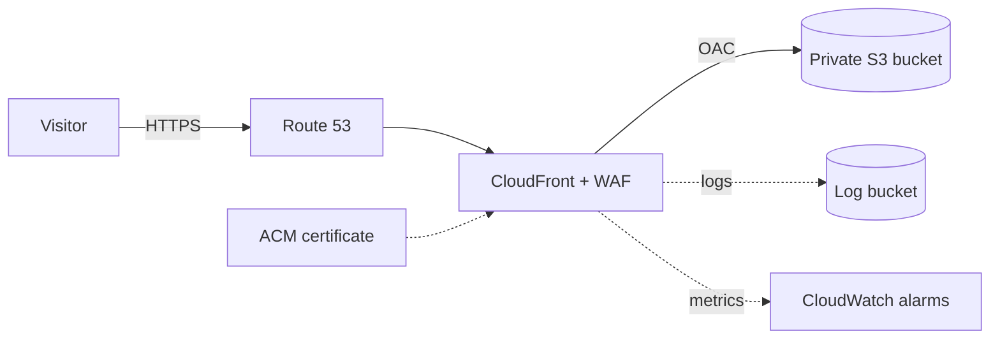

# AWS Static Website

A static website hosted on Amazon S3 and managed with Terraform. Deployed automatically with GitHub Actions.



## Project layout

| Path | Purpose |
|---|---|
| `website/` | Site files, uploaded to S3 |
| `infrastructure/` | Terraform: bucket, public access settings, bucket policy, website config |
| `.github/workflows/deploy.yml` | CI/CD workflow |

## Deploy with CI/CD (recommended)

Push to `main`. The workflow deploys only what changed:

| Changed folder | Job | Action |
|---|---|---|
| `infrastructure/` | Infrastructure deploy | Terraform `fmt -check`, `init`, `validate`, `plan`, `apply` |
| `website/` | S3 deploy | `aws s3 sync website/ s3://static-website-dev-061700273493 --delete` |

- Neither changed: nothing is deployed.
- Both changed: infrastructure runs first; S3 deploy is skipped if it fails.
- Manual run (**Actions → CI/CD → Run workflow**): runs both.

**Setup:** add these repository secrets (Settings → Secrets and variables → Actions):

| Secret | Value |
|---|---|
| `AWS_ACCESS_KEY_ID` | Access key of a dedicated IAM user |
| `AWS_SECRET_ACCESS_KEY` | Matching secret key |

The IAM user needs:
- **State bucket:** `s3:ListBucket`, `s3:GetObject`, `s3:PutObject`, `s3:DeleteObject` (delete is for the lock file).
- **Site bucket:** permission to manage its configuration and policy (Terraform), plus `s3:ListBucket`, `s3:PutObject`, `s3:DeleteObject` (website sync).

## Run locally

**Prerequisites:** AWS CLI v2, Terraform >= 1.10, and the existing state bucket `terraform-state-bucket-20261102` (set in [`infrastructure/main.tf`](infrastructure/main.tf)).

```bash
# 1. Configure credentials
aws configure --profile terraform

# 2. Initialize and deploy infrastructure
cd infrastructure
export AWS_PROFILE=terraform   # the backend can't read Terraform variables
terraform init
terraform plan
terraform apply

# 3. Get the site URL
terraform output -raw website_url
```

`terraform apply` also uploads everything in `website/`. The commands below assume you are still in `infrastructure/`. To update only the site:

```bash
aws s3 sync ../website/ s3://static-website-dev-061700273493 --delete --profile terraform
```

Preview the site without AWS:

```bash
cd ../website && python3 -m http.server 8000   # http://localhost:8000
```

Remove the site infrastructure (run from `infrastructure/`):

```bash
terraform destroy
```

`terraform destroy` removes only the resources managed by this configuration (the site bucket and its settings). It does not delete the separate state bucket `terraform-state-bucket-20261102`, which is created and managed outside this project.

Remote state: the Terraform state has already been migrated to the S3 backend, so no migration step is needed. `terraform init` connects to the remote state automatically.

## Configuration

Defaults are in [`infrastructure/variables.tf`](infrastructure/variables.tf). Override with `-var` or a `terraform.tfvars` file (git-ignored).

| Variable | Default | Purpose |
|---|---|---|
| `aws_region` | `us-west-2` | Bucket region |
| `aws_profile` | `terraform` | AWS CLI profile (CI sets it empty) |
| `project_name` | `static-website` | Bucket name prefix, `Project` tag |
| `environment` | `dev` | Bucket name part, `Environment` tag |
| `website_dir` | `../website` | Folder uploaded to S3 |
| `tags` | `{}` | Extra tags on all resources |

The bucket is named `<project_name>-<environment>-<account-id>`. If you change any of these or the region, update `BUCKET` and `AWS_REGION` in the workflow.

## Alternatives Considered

| Option | Summary | Pros | Cons | Status |
|---|---|---|---|---|
| **S3 static website hosting** | Public bucket serving files directly over HTTP | Simplest setup, very low cost, no servers, fully managed with Terraform | HTTP only, bucket must be public, no CDN or caching, no custom domain with HTTPS | **Chosen** (implemented) |
| **CloudFront + private S3 (OAC)** | Private bucket, only CloudFront can read it, HTTPS redirect | HTTPS, caching, edge delivery, bucket stays private, supports custom domain | Needs a verified AWS account | Attempted, blocked: account verification requires AWS Support contact and several days of waiting. Target design for the future. |
| **AWS Amplify Hosting** | Managed hosting with built-in Git-based CI/CD | Fastest to start, includes HTTPS and CDN, preview deployments | Less control over infrastructure, more abstraction than needed, adds cost and another service, and is built on CloudFront, so it may be affected by the same account restriction (not verified) | Not pursued |
| **EC2 + Nginx** | Virtual machine running a web server | Full control, can run dynamic or custom server logic | Highest effort and cost; patching, scaling, monitoring and TLS are all our responsibility; overkill for static files | Not suitable |

## Production Architecture and Multi-Team Collaboration

This section describes how a production version could look. **None of it is implemented**; the current project is the S3-only setup described above.

### Target architecture



- Private S3 bucket with Block Public Access enabled and versioning on; only CloudFront can read it (OAC).
- CloudFront with HTTPS redirect, a custom domain, and an ACM certificate.
- Optional AWS WAF, access logging and CloudWatch alarms.

### Team responsibilities

| Team | Responsibilities |
|---|---|
| **Platform** | Owns the Terraform modules, remote state, CI/CD pipeline templates, environment provisioning and cost tracking. |
| **Frontend** | Owns the site content in `website/`, build output, cache headers and content testing. Ships changes through the pipeline without direct AWS access. |
| **Security** | Defines IAM and bucket policy standards, reviews infrastructure changes, manages WAF rules, secrets and key rotation (or OIDC), and runs scans. |
| **SRE** | Owns availability targets, monitoring and alerting, incident response, rollback procedures and runbooks. |

### Environments

`dev` → `staging` → `prod`, each with its own bucket, state key and variables, and ideally separate AWS accounts. The same Terraform code is used for all environments; only variables differ. Production deploys require approval.

### Reviews and CI/CD

- All changes go through pull requests on a protected `main` branch, with required reviews (code owners: Platform for `infrastructure/`, Frontend for `website/`).
- Pull requests run `terraform fmt`, `validate`, `plan` (posted to the PR) and security scanning.
- Merging deploys to `dev` automatically; `staging` and `prod` use a protected GitHub Environment with manual approval.
- CI authenticates to AWS with GitHub OIDC and least-privilege roles, with no stored access keys.
- Website deploys sync files, then invalidate the CloudFront cache.

### Testing

- Infrastructure: `tflint`, `tfsec` or `checkov`, and `terraform plan` review.
- Website: HTML and link checks, and a smoke test (HTTP 200 and HTTPS redirect) after each deploy.

### Monitoring

- CloudFront metrics (error rates, latency) and CloudWatch alarms routed to the on-call SRE.
- Access logs for troubleshooting, and an external uptime check.
- Budget alerts for cost.

### Rollback

- **Website:** with bucket versioning, restore the previous object versions, or redeploy a previous commit and invalidate the cache.
- **Infrastructure:** revert the pull request and let the pipeline apply the previous configuration; state versioning provides a further fallback.

## AI Usage

I used AI tools as assistants while building this project. I reviewed and was responsible for everything that was committed.

| Tool | How I used it |
|---|---|
| **ChatGPT** | General questions: AWS services, hosting options, Terraform and GitHub Actions concepts. |
| **GitHub Copilot** | Creating files and first iterations: `.gitignore`, this README and other documentation, and initial drafts of some Terraform and workflow files. Also helped troubleshoot errors, such as a failing `terraform fmt` check. |

**Goals:** get to a working first version quickly, learn the AWS and Terraform options, and keep the documentation consistent with the code.

**Validation:**
- Ran `terraform fmt`, `validate` and `plan` and checked the results before applying.
- Reviewed generated code and edited it to match the actual setup (for example, switching from CloudFront to S3-only because of the account restriction).
- Checked the workflow behavior in GitHub Actions runs and fixed issues found there.
- Compared documentation against the real configuration.

**Benefits:** faster setup, less boilerplate, quicker troubleshooting and clearer documentation.

**Limitations:**
- Generated output can be wrong or out of date, so it always needs review and testing.
- The tools did not know my AWS account constraints, so some first drafts (such as the CloudFront design) did not fit.
- Suggestions can include more than is needed, so I kept only what the project requires.
- AI is not a substitute for understanding what is deployed.

## Notes

This is a small project, and several choices below are deliberate trade-offs rather than best practice. See the production section above for how each would be improved.

| Area | Current state | Why |
|---|---|---|
| Hosting | Public S3 static website endpoint, HTTP only, Block Public Access off, public-read bucket policy | CloudFront could not be used: the AWS account needs verification, which requires contacting AWS Support and waiting several days. S3-only hosting was the available option. |
| HTTPS, CDN, caching, custom domain | Not available | Follow from the S3-only constraint. S3 website endpoints don't support HTTPS, and a CDN, certificate and domain all depend on CloudFront. |
| Terraform deploys | Applied automatically on push to `main` | `main` is a protected branch. Changes go through a pull request, so review happens before the push that triggers the apply. |
| AWS credentials | Long-lived IAM access keys stored as repository secrets | Simplest setup for a small project. |
| Environments | A single `dev` environment | A small project doesn't need more. |
| IAM permissions | The CI IAM user's permissions are broader than needed | Faster to set up. Can be reduced. |
| Hard-coded values | Bucket name, region and state backend are written directly in the workflow and Terraform | Saved time. The README notes where to update them. |
| Testing | No automated tests or scanners; the workflow only runs `fmt` and `validate` | Same reason: saved time. |
