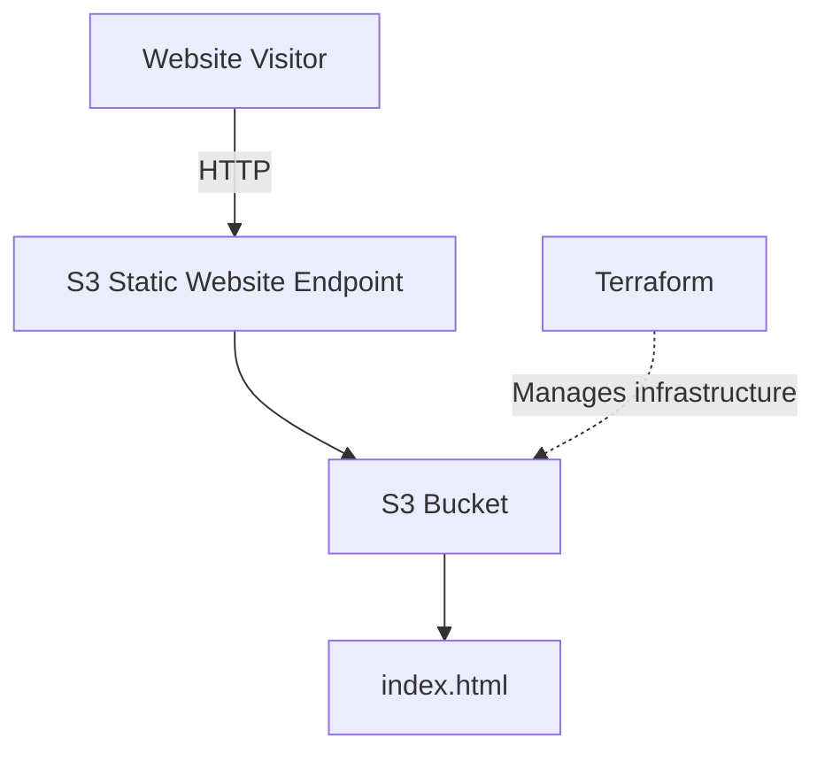

# AWS Static Website

A simple static website hosted on Amazon S3, displaying my name.

## Architecture



The website is served directly from S3. Terraform is used to provision and manage the AWS resources.

## Project layout

| Path | Purpose |
|---|---|
| `website/` | Static site files (uploaded to S3) |
| `infrastructure/` | Terraform configuration (S3 bucket, public access settings, bucket policy, website config) |
| `.github/workflows/deploy.yml` | CI/CD workflow |

## Deploying

There are two ways to deploy. Day to day, use CI/CD. Use the local route for the first setup or when you want to try something by hand.

### Option 1: CI/CD (recommended)

1. Edit files in `website/` and/or `infrastructure/`.
2. Commit and push to `main`.
3. The workflow deploys only what changed (see [CI/CD](#cicd)). Follow progress in the repository's **Actions** tab.

To redeploy everything without a code change, use **Actions → CI/CD → Run workflow**.

### Option 2: Run locally

**Prerequisites:** AWS CLI v2, Terraform >= 1.10, and an existing S3 bucket for Terraform state (`terraform-state-bucket-20261102`, configured in [`infrastructure/main.tf`](infrastructure/main.tf)).

1. Configure AWS credentials under the `terraform` profile:

```bash
aws configure --profile terraform
```

2. Initialize Terraform and review the plan:

```bash
cd infrastructure
export AWS_PROFILE=terraform   # the backend needs this; it can't read Terraform variables
terraform init
terraform plan
```

3. Apply:

```bash
terraform apply
```

This creates the bucket and uploads everything in `website/`.

4. Get the website URL:

```bash
terraform output -raw website_url
```

5. Update the website. Either re-run `terraform apply` (it re-uploads changed files), or sync directly:

```bash
aws s3 sync website/ s3://static-website-dev-061700273493 --delete --profile terraform
```

6. Preview the site locally before deploying (no AWS needed):

```bash
cd website
python3 -m http.server 8000   # open http://localhost:8000
```

7. Remove everything:

```bash
cd infrastructure
terraform destroy
```

If you applied earlier with local state, run `terraform init -migrate-state` once to move it into the S3 backend.

### Configuration

Defaults live in [`infrastructure/variables.tf`](infrastructure/variables.tf). Override with `-var` or a `terraform.tfvars` file (git-ignored).

| Variable | Default | Purpose |
|---|---|---|
| `aws_region` | `us-west-2` | Region for the bucket |
| `aws_profile` | `terraform` | AWS CLI profile (CI sets it empty) |
| `project_name` | `static-website` | Bucket name prefix and `Project` tag |
| `environment` | `dev` | Bucket name part and `Environment` tag |
| `website_dir` | `../website` | Folder uploaded to S3 |
| `tags` | `{}` | Extra tags on all resources |

The bucket name is `<project_name>-<environment>-<account-id>`. If you change it, update `BUCKET` in the workflow and in the commands above.

## CI/CD

One workflow, [`.github/workflows/deploy.yml`](.github/workflows/deploy.yml), runs on pushes to `main` (or manually from the Actions tab) with two jobs:

| Job | Runs when | What it does |
|---|---|---|
| Infrastructure deploy | `infrastructure/**` changed | Terraform `fmt -check`, `init`, `validate`, `plan`, `apply` |
| S3 deploy | `website/**` changed | `aws s3 sync website/ s3://static-website-dev-061700273493 --delete` |

If neither folder changed, nothing is deployed. If both changed, infrastructure deploys first, and S3 deploy is skipped if it fails. Manual runs execute both. The S3 sync removes files from the bucket that were deleted from `website/`.

- **Terraform state:** stored remotely in the S3 backend configured in [`infrastructure/main.tf`](infrastructure/main.tf) (bucket `terraform-state-bucket-20261102`, with encryption and S3 lock file). CI sets `TF_VAR_aws_profile=""` so it uses the secrets instead of the local `terraform` profile.

**Required repository secrets** (Settings → Secrets and variables → Actions):

| Secret | Purpose |
|---|---|
| `AWS_ACCESS_KEY_ID` | Access key of a dedicated IAM user |
| `AWS_SECRET_ACCESS_KEY` | Secret for that access key |

The IAM user needs:
- Access to the state bucket: `s3:ListBucket`, `s3:GetObject`, `s3:PutObject` and `s3:DeleteObject` (the last for the lock file).
- Permissions to manage the site bucket's configuration, policy and objects (Terraform apply), plus `s3:ListBucket`, `s3:PutObject` and `s3:DeleteObject` for the website sync.

If you change `project_name`, `environment` or the region, update `BUCKET` and `AWS_REGION` in the workflow to match.

## Notes

The current implementation uses public S3 static website hosting over HTTP. A production deployment would use private S3 storage behind CloudFront with OAC and HTTPS.